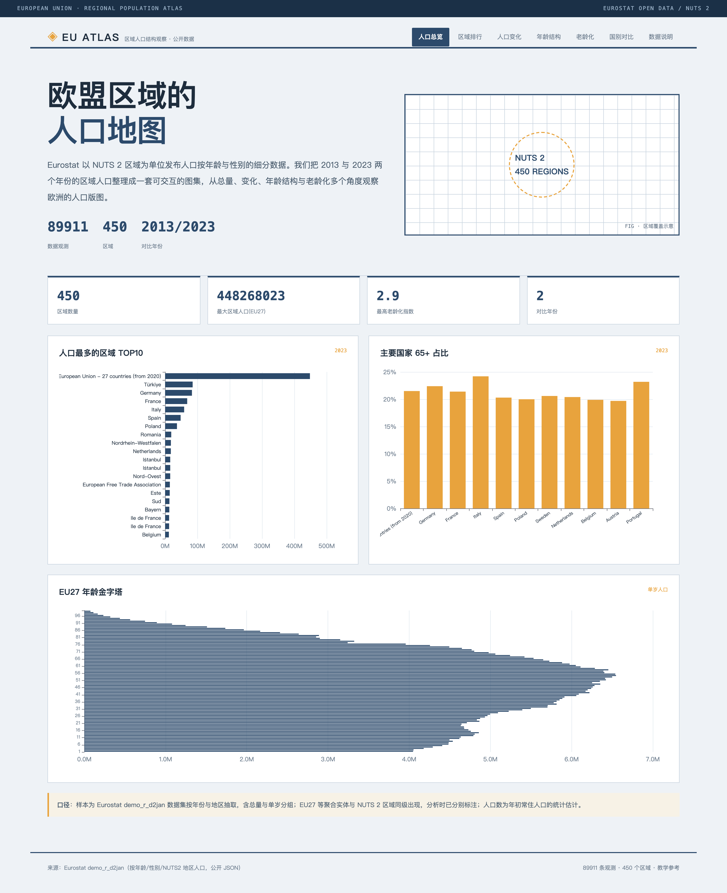
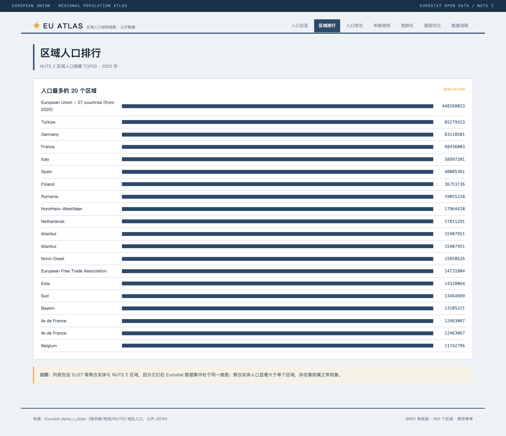
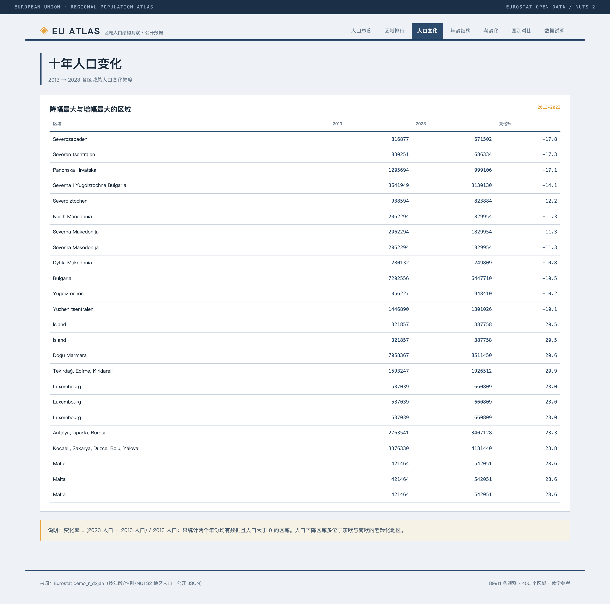
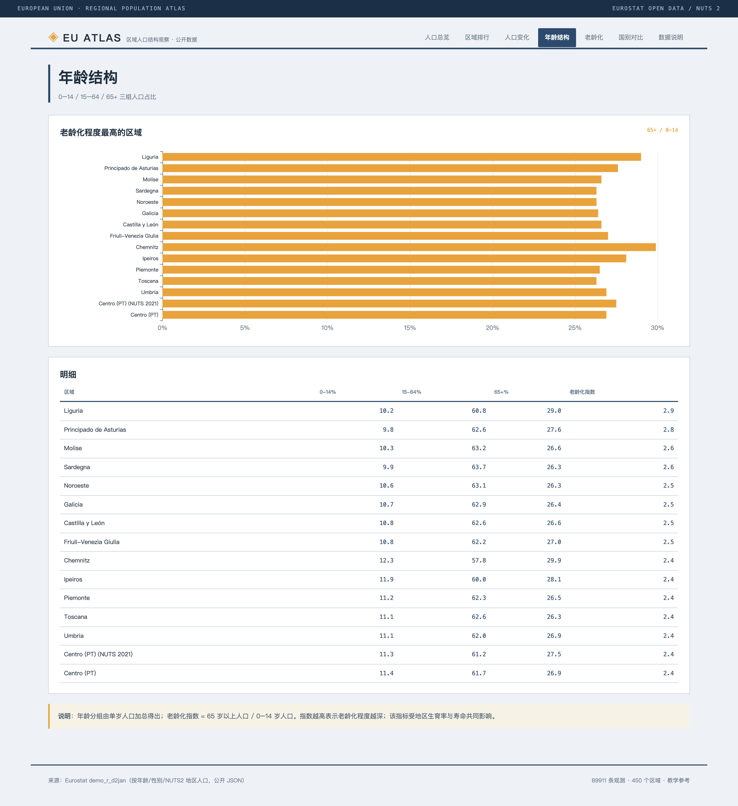
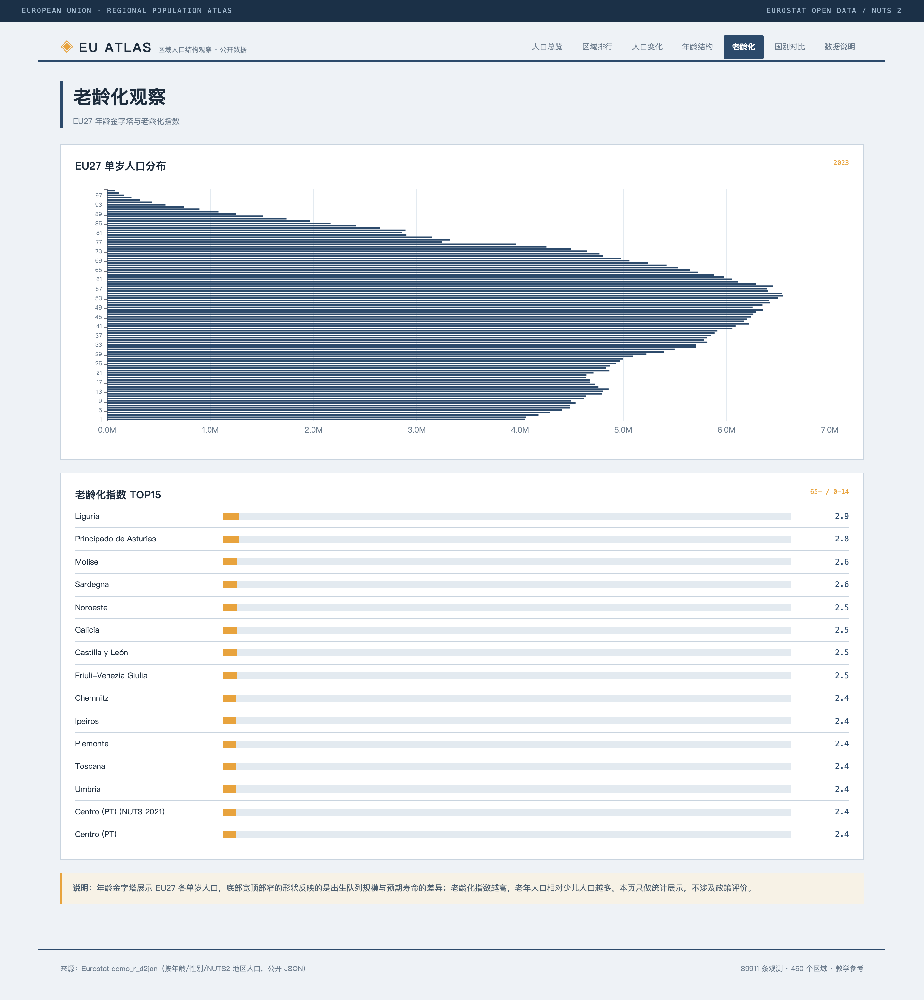
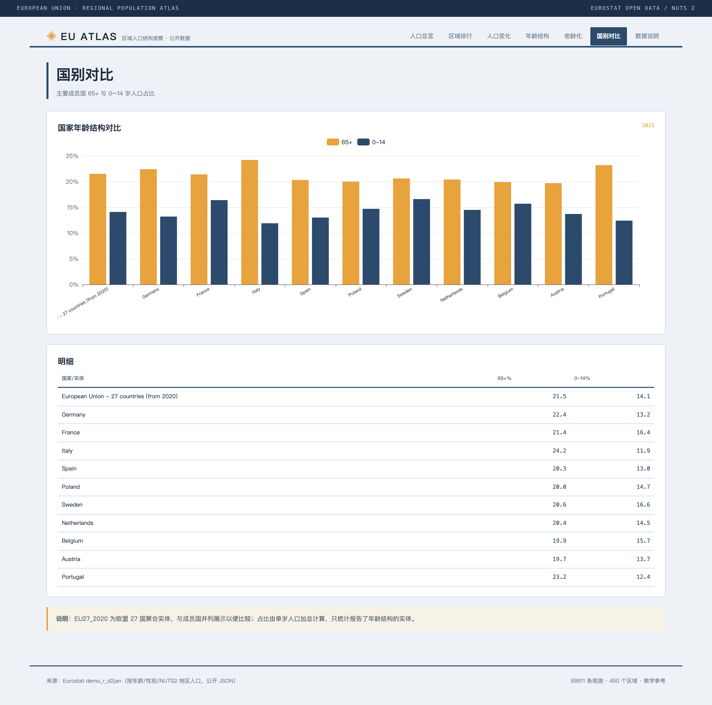
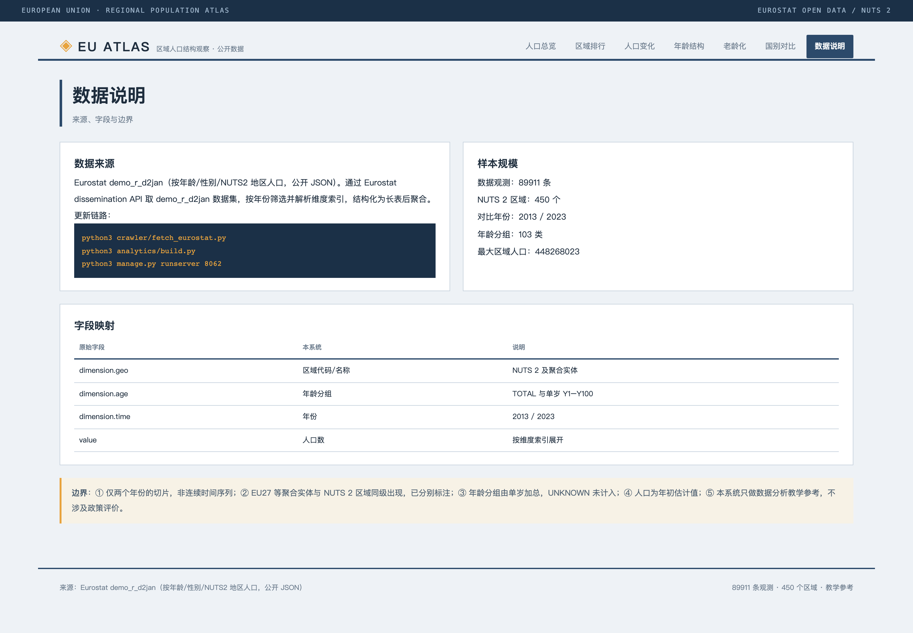

# 062 基于Eurostat公开数据的欧盟区域人口结构分析系统-设计展示

> **代码有偿获取 可接受定制 微信联系方式: csbysj2020 或 ACE2487，备注(BS)**

> **完整源码与全套文档 · 在线自助获取 >>> [https://mbd.pub/o/bread/YZaWmJpqbA==](https://mbd.pub/o/bread/YZaWmJpqbA==)**

> **成品页（功能介绍 / 更多选题）>>> [https://bishe.suilang.net/products/eu-atlas](https://bishe.suilang.net/products/eu-atlas)**

> 

> 

## 视频

> **点击查看 >>> [https://www.bilibili.com/video/BV1eUy4z8E4Z/](https://www.bilibili.com/video/BV1eUy4z8E4Z/)**

## 项目简介

欧盟行政图集风格（冷蓝灰、琥珀强调、技术网格），区别于海报/账册/画廊/星空/控制台/田野指南。采集 Eurostat 公开区域人口数据 89911 条观测、450 个 NUTS 2 区域，从区域总量、十年变化、年龄结构、老龄化与国别对比五维分析。Django + ECharts（本地化离线可用），7 个页面。聚合实体与区域同级、年龄分组加总口径如实标注，仅作教学参考，不涉及政策评价。

区域人口结构是观察区域发展与社会变迁的基础。

本项目设计并实现了一套基于 Eurostat 公开数据的欧盟区域人口结构分析系统：通过 dissemination API 取 demo_r_d2jan 数据集，解析维度索引后入库 89911 条观测（覆盖 450 个 NUTS 2 区域），从区域总量、十年变化、年龄结构、老龄化指数与国别对比五个维度聚合分析。

系统采用 Django + ECharts 与欧盟行政图集式界面（冷蓝灰、琥珀强调、技术网格），实现人口总览、区域排行、人口变化、年龄结构、老龄化、国别对比、数据说明 7 个页面。

本仓库为**设计展示**：包含项目说明、技术架构、实验结果与运行截图；完整源码、任务书、开题报告、毕业论文与使用说明可通过上方链接自助获取，成品页可查看更多选题，也可联系微信咨询定制。

## 功能特性

1. 差异化视觉：欧盟行政图集（冷蓝灰/琥珀/技术网格），非海报/账册/画廊/星空/控制台/田野指南

2. 真实采集：Eurostat demo_r_d2jan 公开免 key，89911 条观测、450 个区域

3. 五维分析：区域总量/十年变化/年龄结构/老龄化/国别对比

4. 区域排行：NUTS 2 区域人口 TOP20，聚合实体已标注

5. 人口变化：2013→2023 十年增减，东欧部分区域降幅超 17%

6. 老龄化：65+/0-14 指数，最高区域 Liguria

7. 技术栈差异化：Django + ECharts（本地化）

8. 合规边界：聚合实体口径与人口估计如实标注，不涉及政策评价

## 技术架构

| 项目 | 说明 |
| --- | --- |
| 编程语言 | Python 3.8+ |
| Web 框架 | Django 4.2 |
| 图表 | ECharts（本地化离线可用） |
| 数据源 | Eurostat dissemination API（公开免 key） |
| 样本规模 | 89911 观测 / 450 区域 |
| 运行端口 | http://127.0.0.1:8062 |
| 说明 | 数据直读 analysis JSON，无需数据库 |

## 目录结构

以下为完整交付版的结构（本仓库仅作设计展示）：

```
eu-atlas/
├── analytics/
│   └── build.py
├── crawler/
│   └── fetch_eurostat.py
├── data/
│   ├── analysis/
│   │   ├── changes.json
│   │   ├── countries.json
│   │   ├── pyramid.json
│   │   ├── regions.json
│   │   ├── structure.json
│   │   └── structure_low.json
│   ├── processed/
│   │   └── population.csv
│   └── stats.json
├── euapp/
├── eusite/
│   ├── __init__.py
│   ├── settings.py
│   ├── urls.py
│   ├── views.py
│   └── wsgi.py
├── static/
│   ├── css/
│   │   └── style.css
│   └── vendor/
│       └── echarts.min.js
├── templates/
│   ├── about.html
│   ├── aging.html
│   ├── base.html
│   ├── changes.html
│   ├── countries.html
│   ├── overview.html
│   ├── regions.html
│   └── structure.html
├── 任务书/
│   └── 毕业设计任务书.docx
├── 开题报告/
│   └── 毕业设计开题报告.docx
├── 最终论文/
│   ├── 图/
│   └── …
└── …
```

## 数据与实验结论

- 实验显示样本覆盖 450 个区域，老龄化指数最高的区域为 Liguria。
- 真实采集：Eurostat demo_r_d2jan 公开免 key，89911 条观测、450 个区域
- 区域排行：NUTS 2 区域人口 TOP20，聚合实体已标注
- 人口变化：2013→2023 十年增减，东欧部分区域降幅超 17%

## 交付内容

1. 完整源码（Django 应用 + 采集器 + 分析引擎 + 7 页面）
2. 真实数据（population.csv + analysis JSON）
3. 任务书与开题报告（Word）
4. 毕业论文（Word 七章制）
5. 二次开发说明（Word+md）
6. 7 张截图 + 封面 + 演示视频

## 常见问题

**为什么视觉风格和其他成品差这么多？**

刻意设计：欧盟行政图集风格替代看板/海报/画廊，是差异化探索。

**只有两个年份吗？**

是，2013 与 2023 切片，页面与论文均说明，不是连续时间序列。

**为什么EU27排在区域前面？**

聚合实体与 NUTS 2 区域在同一维度，已分别标注。

**年龄结构怎么算的？**

由单岁人口加总到 0-14/15-64/65+ 三组，UNKNOWN 未计入。

**图表能离线用吗？**

能，echarts.min.js 已本地化到 static/vendor/。

## 截图








